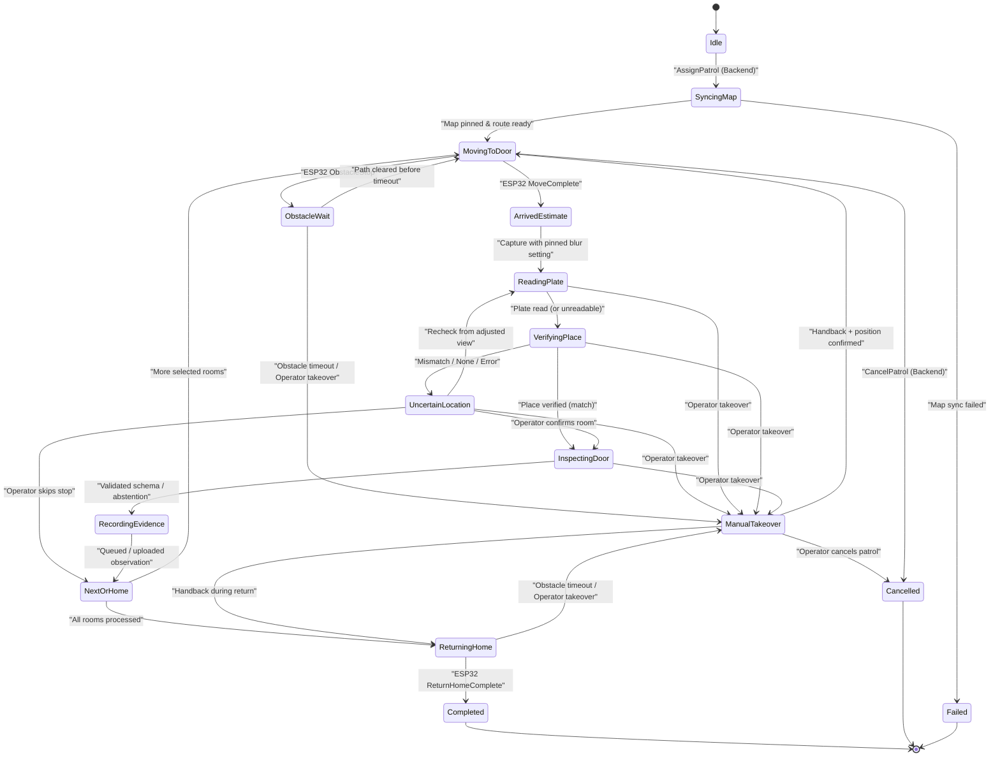

# Phase 1 — Patrol State Machine, Ownership & Message Contracts

This document records the Phase 1 contracts for [MOBILE_IMPLEMENTATION_PLAN.md](MOBILE_IMPLEMENTATION_PLAN.md). Local-first operation and optional face blur below supersede the cloud-only and always-blurred assumptions in [PROPOSAL_v2.md](PROPOSAL_v2.md). Handset checks remain to be completed.

---

## 1. Target Device, Stack & Transport Record

| Item | Decision / Status | Notes |
| --- | --- | --- |
| **Mobile Stack** | **Kotlin (Native Android)** | CameraX + ML Kit Face Detection (on-device blur), Coroutines/StateFlow, `kotlinx.serialization`, Foreground Service + `WakeLock`. |
| **Target Handset & OS** | **OnePlus Nord N10 5G (6 GB RAM, Android / OxygenOS)** | Recorded for Phase 1; disable OxygenOS battery optimization for the ROVA app so Foreground Service + BLE/USB stay alive under screen lock. |
| **ESP32 Transport** | **Primary: BLE GATT; Wired Alternative/Fallback: USB-C OTG Serial** | OnePlus Nord N10 supports USB Host (OTG) over USB-C (`usb-serial-for-android` for CP2102/CH340/CDC). Both sit behind a single `Esp32Transport` interface in Kotlin. |
| **Cloud AI Route** | **Phone → Backend Proxy → Provider** | Provider keys (`NEBIUS_API_KEY`, `NVIDIA_API_KEY`) stay on the FastAPI backend; the phone authenticates only with the backend. |

### Local first, cloud later

Start with replay or a backend running on a development computer on the same Wi-Fi/hotspot. Local does not assume that a large VLM runs on the phone.

- **Replay:** Bundled versioned map, recorded perception responses, simulated ESP32, and local observations. No internet or backend required.
- **Local live:** Phone → authenticated LAN backend → local OCR/detector/model adapter. Console, maps, and evidence storage can also run locally. Missing local capabilities return unavailable/unknown or ask the operator; recorded outputs remain explicitly labelled replay.
- **Cloud later:** Phone → hosted backend → configured provider and remote storage. A LAN backend calling a hosted model is still cloud perception. WhatsApp requires its external service.
- Configure `execution_mode: replay | local | cloud`, `backend_base_url`, and `perception_provider: recorded | local | cloud`. Record the effective route with each result. Never silently enable cloud calls after a local failure.
- Use the computer’s reachable LAN address on the phone, not `localhost`. Live deployment uses authenticated HTTPS; debug HTTP allowances must be limited to the development endpoint.
- Keep API schemas and pinned map versions identical across routes. Use local storage adapters before Supabase integration, queue observations during disconnects, and defer external notifications when offline.
- Change routes deliberately while idle. The direct phone–ESP32 link and local safety loop are independent of this choice. The cloud route in the table above is the later deployment option.

### How the ESP32 transport works

The phone coordinates commands; the ESP32 controls motors and reads safety sensors. Images never go to the ESP32. Neither BLE nor USB needs internet.

1. Kotlin uses one `Esp32Transport` interface: `connect()`, `send(command)`, `events`, and `disconnect()`. Simulator, BLE, and USB implementations carry the same commands.
2. **BLE GATT:** Android is the central/client; ESP32 is the advertising peripheral/server. Define a ROVA service with a command characteristic (write with response) and an event characteristic (notifications). Discover and subscribe before issuing commands; freeze UUIDs in shared protocol configuration during implementation.
3. **USB-C OTG serial:** Connect the phone as USB host through an OTG/data cable to the board’s supported USB-to-serial interface. Request Android USB permission and open the serial port. Initial protocol setting: 115200 baud, 8 data bits, no parity, 1 stop bit. Verify the actual board driver, cable, and handset before selecting this adapter.
4. Use UTF-8 newline-delimited JSON, maximum 4096 bytes per message. Buffer until a complete line arrives. BLE fragments messages to the negotiated payload size; USB reads can also split/coalesce messages. Reject oversized/malformed frames.
5. A successful write is not a motion acknowledgement. ESP32 sends application `ack` within 200 ms, followed by completion/interruption with the same command/session IDs. Reconcile status before retrying; duplicate command IDs cannot execute motion twice.
6. Send heartbeat every 100 ms. ESP32 stops after 500 ms without a valid heartbeat/manual command, including during autonomous moves. Sensors and E-stop always override motion locally.
7. Select only one active transport. On disconnect or BLE/USB switching, stop, reconnect, query `get_status`, and reconcile command IDs and position before explicit handback. Never replay queued manual-drive commands.

### Face blur setting

Expose **Face blur: On / Off**, default **On**, configurable before patrol start. Off bypasses face detection/blurring and permits unblurred previews, local storage, perception requests, and evidence uploads on the selected route. Display the setting before starting, including that cloud mode can transmit unblurred images. This is an explicit operator choice, never an automatic fallback after blur failure.

All export paths use one frame-policy interface. Every frame, request, and observation carries `face_blur_enabled` and `privacy_applied: blurred | unblurred`. With On, processing failure withholds the frame; “blurred” records processing, not guaranteed detection of every face. With Off, export is allowed without face processing. Pin the setting for the patrol; changes apply to the next patrol. Queued evidence retains its original metadata. Department recording permissions still apply.

This setting replaces unconditional blur requirements elsewhere in this document: “capture and blur” means apply the pinned frame policy, and “blurred evidence” describes the default-On example.

### Handset Evaluation Checklist (Run on Target Phone)
- [ ] CameraX still capture works at mounting height with torch (`enableTorch(true)`) in low-light corridors.
- [ ] On-device face detection + blur runs in-memory (`ImageProxy` → blurred JPEG) with raw buffers discarded.
- [ ] Foreground Service (`camera` + `connectedDevice`) + `PARTIAL_WAKE_LOCK` keeps patrol loop and ESP32 link alive for ≥ 15 min with screen locked.
- [ ] Reconnect behavior verified when ESP32 link or Wi-Fi/cellular drops mid-stop.

---

## 2. Patrol State Diagram

[Separate PNG diagram](diagrams/patrol-state-control.png) · [Editable Graphviz source](diagrams/patrol-state-control.dot)

The phone owns these states in replay, local, and cloud modes. Assignment comes from the selected backend (or replay controller). Capture uses the pinned face-blur setting.

Global rules supplement the diagram: takeover from any active state stops/cancels motion and enters ManualTakeover; cancellation stops motion and enters Cancelled; fatal error stops motion and enters Failed. An unreachable controller means stop is unconfirmed until watchdog/status reconciliation. ObstacleWait remembers outbound versus return travel and resumes only reconciled remaining movement; uncertain progress requires operator position confirmation. Recoverable frame/perception failures produce unknown/review; upload failures queue evidence locally before proceeding.



---

## 3. Component Ownership & Control Priority

### Transition Ownership

| Transition / Responsibility | Owner | Rule |
| --- | --- | --- |
| Assign patrol, cancel patrol, authorize takeover/handback | **Backend** (triggered by Console) | Phone validates `patrol_id` and `control_session_id`. |
| Patrol state transitions, stop sequencing, place verification decision | **Phone** | Runs the deterministic state machine; never lets a late reply resume a suspended/taken-over patrol. |
| Bounded motion (`move_edge`, `turn`, `face_door`, `return_home`) | **ESP32** | Executes timed/IMU-closed-loop moves and reports completion or interruption. |
| Speed limit, obstacle stop, bumper/downward-sensor halt, watchdog, E-stop | **ESP32** | Always enforced locally on ESP32, **including during manual control**. |
| Face blurring & privacy gate | **Phone** | Enforces the pinned On/Off setting. With On, processing failure withholds export; with Off, unblurred export is allowed and labelled. |
| Perception & candidate retrieval | **Selected local/cloud backend** | Uses configured local/cloud adapters, keeps any provider keys off the phone, and enforces schema/timeout. |

### Manual Control Priority
1. **Immediate preemption:** The selected backend alone allocates the next `control_session_id` on takeover/handback (the replay controller emulates it). The phone adopts the supplied value and immediately enters `ManualTakeover` on takeover.
2. **In-flight invalidation:** The Phone sends `cancel_motion` to the ESP32 using the supplied session ID, without incrementing it again. Any late perception response or `MoveComplete` from an older `control_session_id` or `stop_id` is **discarded**.
3. **Expiring manual commands:** Manual drive commands (`forward`, `backward`, `turn_left`, `turn_right`, `stop`) carry `issued_at_ms` and `ttl_ms` (default `400 ms`). The Phone drops expired commands before relaying; the ESP32 watchdog halts motors if no valid command arrives within `500 ms`.
4. **Explicit handback:** Autonomous control resumes only on an explicit `Handback` message with a confirmed `current_node_id` (or `return_home` target).

### Reconnect Reconciliation
- **Phone ↔ ESP32:** On reconnect, the Phone queries `get_status`. The ESP32 returns its `last_command_id`, `command_state` (`idle`, `running`, `completed`, `interrupted`), `control_session_id`, and `interruption_reason`.
  - If `last_command_id` already completed, the Phone advances without re-issuing the move (idempotent).
  - If the ESP32 halted due to watchdog timeout during disconnect, the Phone enters `ObstacleWait` or `ManualTakeover` and notifies the Backend.
- **Phone ↔ Backend:** On reconnect, the Phone sends its current `patrol_id`, `state`, `control_session_id`, and any locally queued `StopObservation` records (with `idempotency_key`). Backend deduplicates by `(patrol_id, stop_id)`.

---

## 4. End-to-End Walkthroughs (Home → One Door → Home)

| Scenario | Sequence |
| --- | --- |
| **1. Happy path** | Backend assigns `patrol_1` (`map_version: 3`, `selected_room_ids: ["lab_3"]`). Phone pins map → ESP32 `move_edge` + `face_door` → Phone captures & blurs frame → Backend proxy `read_plate` (`"Lab 3"`) → `verify_place` matches `lab_3` → `inspect_door` returns `door_state: "open"`, `occupancy: "occupied"` (`count: 2`), `lights: "on"`, `projector: "off"` → Phone uploads observation + evidence ref → ESP32 `return_home` → `Completed`. |
| **2. Wrong plate** | At `lab_3` estimate, `read_plate` returns `"Lab 2"` (or `verify_place` returns `"none"`). Phone enters `UncertainLocation`, keeps `requested_room_id: "lab_3"` and `verified_room_id: null`, and asks operator via Backend (`recheck`, `confirm_room`, `skip`, or `takeover`). Evidence is **never** silently attached to `lab_3`. |
| **3. Blocked route** | During `MovingToDoor`, ESP32 front ultrasonic / downward sensor triggers `ObstacleStop`. ESP32 halts immediately and reports `interrupted: "obstacle"`. Phone enters `ObstacleWait` (e.g., 15 s). If cleared, Phone resumes; if timeout expires, Phone notifies Backend and waits for `Takeover` or `Cancel`. |
| **4. Closed door** | `verify_place` confirms `lab_3`. `inspect_door` returns `door_state: "closed"`, `occupancy: "cannot_determine"`, `lights: "cannot_determine"` (or `"light_under_door"` if visible), `projector: "cannot_determine"`. Recorded with blurred evidence photo. |
| **5. Takeover during inspection** | While `inspect_door` is in flight, operator clicks **Take Over** in Console. Backend sends `Takeover` (`control_session_id: 2`). Phone transitions to `ManualTakeover`, cancels any pending motion, and drops the late `inspect_door` HTTP reply when it arrives (matching `control_session_id: 1 != 2`). |

---

## 5. Message Contracts

All messages use JSON over UTF-8 with ISO-8601 timestamps or Unix epoch milliseconds (`*_ms`).

### 5.1 Backend → Phone
- **Ordering & Idempotency:** Monotonic `seq` per `patrol_id`; `control_session_id` increments on every takeover/handback.
- **Acknowledgements:** Phone replies with `ack` (`command_id`, `status: "accepted" | "rejected"`, `reason`).
- **Timeouts:** Patrol assignment ack within `5 s`; manual drive commands expire after `ttl_ms` (`400 ms`).

```json
// 1. Assign Patrol
{
  "type": "assign_patrol",
  "command_id": "cmd_001",
  "seq": 1,
  "patrol_id": "patrol_20261125_01",
  "map_version": 3,
  "selected_room_ids": ["lab_3"],
  "control_session_id": 1,
  "issued_at_ms": 1764068400000
}

// 2. Takeover / Handback
{
  "type": "takeover",
  "command_id": "cmd_002",
  "patrol_id": "patrol_20261125_01",
  "control_session_id": 2,
  "issued_at_ms": 1764068450000
}

{
  "type": "handback",
  "command_id": "cmd_003",
  "patrol_id": "patrol_20261125_01",
  "control_session_id": 3,
  "confirmed_node_id": "lab_3",
  "resume_action": "next_stop",
  "issued_at_ms": 1764068490000
}

// 3. Expiring Manual Command (only valid when control_session_id matches active ManualTakeover)
{
  "type": "manual_drive",
  "command_id": "man_042",
  "patrol_id": "patrol_20261125_01",
  "control_session_id": 2,
  "linear_vel": 0.25,
  "angular_vel": 0.0,
  "issued_at_ms": 1764068455000,
  "ttl_ms": 400
}

// 4. Cancel Patrol
{
  "type": "cancel_patrol",
  "command_id": "cmd_004",
  "patrol_id": "patrol_20261125_01",
  "issued_at_ms": 1764068500000
}
```

### 5.2 Phone ↔ ESP32
- **Ordering & Idempotency:** Every motion command has a unique `command_id` and `control_session_id`. ESP32 deduplicates by `command_id` so retries never repeat a move.
- **Acknowledgements & Timeouts:** ESP32 must send `ack` within `200 ms`. Watchdog halts motors if no heartbeat/manual command arrives within `500 ms`.

```json
// Phone -> ESP32: Bounded Motion Command
{
  "type": "move_edge",
  "command_id": "esp_cmd_101",
  "control_session_id": 1,
  "distance_m": 4.2,
  "heading_deg": 90.0,
  "max_speed_mps": 0.35,
  "timeout_ms": 18000
}

// Phone -> ESP32: Immediate Stop / Cancel
{
  "type": "estop",
  "command_id": "esp_cmd_102",
  "control_session_id": 2
}

// ESP32 -> Phone: Ack / Completion / Interruption / Status
{
  "type": "motion_event",
  "command_id": "esp_cmd_101",
  "control_session_id": 1,
  "status": "interrupted",
  "interruption_reason": "obstacle_ultrasonic",
  "distance_traveled_m": 2.15,
  "heading_deg": 89.4,
  "battery_v": 7.6
}
```

### 5.3 Phone ↔ Perception Service (Backend Proxy)
- **Operations:** `read_plate`, `verify_place`, `inspect_door`.
- **Frame policy:** Apply the pinned On/Off setting before sending `image_b64` or uploading `evidence_ref`. Include `face_blur_enabled`, `privacy_applied`, `execution_mode`, and `perception_provider` on requests and observations. Off permits explicitly labelled unblurred images. Section 5 examples show the default-On cloud route; local adapters use the same schema.
- **Timeouts & Retries:** `10 s` timeout per call; max `1` retry on network/malformed JSON, then fallback model or explicit `status: "failed" | "cannot_determine"`.

```json
// Phone -> Perception Proxy (inspect_door)
{
  "operation": "inspect_door",
  "request_id": "req_901",
  "patrol_id": "patrol_20261125_01",
  "stop_id": "stop_01",
  "control_session_id": 1,
  "frame_id": "frame_blur_01",
  "model": "nemotron-3.5-super-vl",
  "prompt_version": "v1",
  "image_b64": "<blurred_jpeg_base64>"
}

// Perception Proxy -> Phone (Validated Schema)
{
  "request_id": "req_901",
  "status": "ok",
  "model_used": "nemotron-3.5-super-vl",
  "prompt_version": "v1",
  "latency_ms": 1420,
  "tokens_in": 610,
  "tokens_out": 84,
  "result": {
    "door_state": "open",
    "occupancy": "no_one_visible",
    "occupant_count": 0,
    "whole_room_visible": false,
    "lights": "on",
    "projector": "cannot_determine",
    "confidence": 0.86
  }
}
```

### 5.4 Phone → Backend (Progress & Observations)
- **Idempotency:** Retries use the same `(patrol_id, stop_id)` so disconnected uploads never create duplicate observations.
- **Separation of room fields:** `requested_room_id` and `verified_room_id` are always stored separately.

```json
{
  "type": "stop_observation",
  "idempotency_key": "patrol_20261125_01:stop_01",
  "patrol_id": "patrol_20261125_01",
  "stop_id": "stop_01",
  "state": "RecordingEvidence",
  "requested_room_id": "lab_3",
  "verified_room_id": "lab_3",
  "verification_method": "rag_pgvector_vlm",
  "plate_text_read": "Lab 3",
  "evidence_ref": "patrols/patrol_20261125_01/stop_01_blur.jpg",
  "observation": {
    "door_state": "open",
    "occupancy": "no_one_visible",
    "occupant_count": 0,
    "lights": "on",
    "projector": "cannot_determine",
    "confidence": 0.86
  },
  "timestamp_ms": 1764068432000
}
```

---

## 6. Minimal Backend Dependency for Phase 4

Run the first live test against the LAN backend with a local perception adapter, then optionally repeat with the hosted backend/provider. Both expose the endpoints below and accept frame-policy/execution metadata from section 5.3. Local map/evidence adapters can precede Supabase. Replay uses fixtures and needs none of these services. An unavailable local model must abstain rather than silently call the cloud.

To run the **Phase 4 first live cloud test** (stationary phone → blurred plate photo → `read_plate` → local map check) without waiting for the full console or ESP32:
1. `POST /api/v1/perception/read-plate` (FastAPI) accepting `{ request_id, frame_id, image_b64, model }` and proxying to Nebius (`Nemotron 3.5 Super VL`) / NVIDIA (`Cosmos 3 Nano Reasoner`).
2. `GET /api/v1/maps/{map_id}/latest` returning the pinned `map_version`, nodes, edges, and plate texts for the phone's local cache.
3. Device bearer-token auth header (`Authorization: Bearer <DEVICE_TOKEN>`) so no provider keys ever live on the phone.
